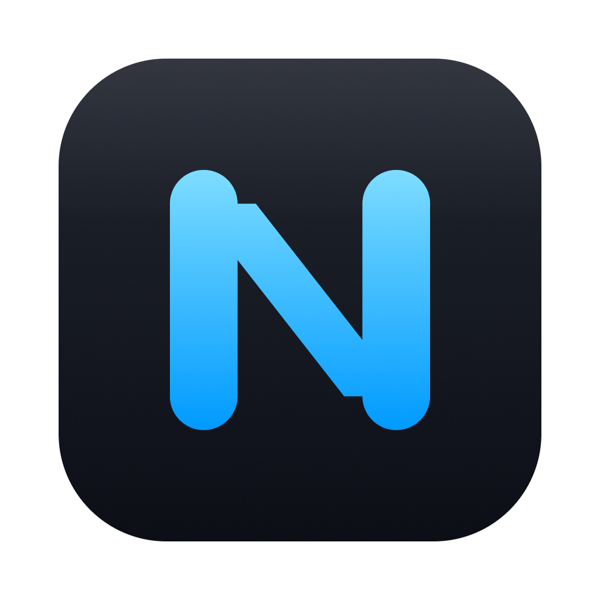
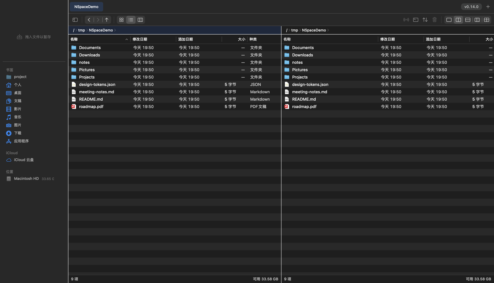

<p align="center">
  
</p>

<h1 align="center">HSpace</h1>

<p align="center">
  A native multi-pane file manager for macOS: <b>QSpace's features, Finder's native feel, performance nobody else has</b>
</p>

<p align="center">
  
  
  <a href="LICENSE"></a>
</p>

> This repository is a fork of [SammySnake-d/NSpace](https://github.com/SammySnake-d/NSpace), used under the MIT license. The original copyright notice is kept in [LICENSE](LICENSE).



## Why HSpace

Finder's information density is too low; QSpace Pro stutters on recent systems and its idle CPU stays high. HSpace implements QSpace-class multi-pane workflows from scratch in pure AppKit and treats performance as a hard metric: **north-star acceptance = 0.0% idle CPU with four panes watching** (FSEvents direct-child filtering plus full suspension of background panes, measured on every release).

## Features

- **Multi-pane layouts**: single / two columns / two rows / three columns / four-way grid (⌃⌘1..5), F5 to copy and F6 to move between panes
- **Workspace tabs**: a tab holds the entire split layout (⌘T / ⌘W / ⌘1..9 to jump, MRU fallback on close), with full session restore
- **Custom-drawn top deck**: workspace tab bar plus icon toolbar, running flush with the full-height sidebar (a Finder-style see-through look)
- **Stash shelf**: drag files onto a stack to hold them, then batch copy / move / AirDrop across directories (action bar appears on hover)
- **Focused search**: ⌘F for the current directory / ⇧⌘F global; name + content + kind filters; **a dedicated hidden-file search channel** (a custom scan outside Spotlight, going beyond QSpace)
- **File operation kernel**: copyfile clone acceleration, byte-level progress, conflict resolution (replace / skip / keep both / merge), undo, operation receipts
- **Archives**: compress to zip / tar.gz (encryption available), extract 20+ formats, wrap-in-folder semantics
- **Take over "reveal in file manager"**: Reveal requests from third-party apps land in HSpace with the target selected (same mechanism as QSpace, can be turned off)
- **Global show/hide hotkey**: bring HSpace to the front or hide it from any app with one key (no Accessibility permission needed)
- Every shortcut is configurable (registry + recorder), columns are selectable and sortable, Space for preview, double-click uses the system default app, light and dark follow the system

## Install

There are no prebuilt releases yet: build it from source.

## Build from source

Only the Xcode Command Line Tools are required (no full Xcode):

```bash
git clone https://github.com/Hoax017/HSpace.git && cd HSpace
./scripts/build-app.sh     # build and sign build/HSpace.app
./scripts/test.sh          # unit tests
./scripts/ui-smoke.sh      # real-effect UI assertions (closes any running HSpace first)
```

## Architecture

Organized according to the composable execution meta-architecture ([META_COMPLIANCE.json](META_COMPLIANCE.json)): every capability is packaged as a **physical pod**. `Contract.swift` is the only public surface, pods are composed through constructor injection, and the presentation layer may not use write-type file APIs (BG-1, mechanically enforced in pre-commit):

```
Sources/
├─ HSpaceContracts/   shared vocabulary (FileItem/OperationSpec/RunState…)
├─ HSpaceKernel/      operation kernel: Run state machine + conflict resolution + progress stream (sole state committer)
├─ Pods/              DirectoryReader · Transfer · LocalOps · ArchiveEngine · DirectoryWatch
│                     BookmarkStore · StashStore · SessionStore · SearchEngine · FolderSize
│                     IconThumb · VolumeInfo · PathComplete
└─ HSpaceApp/         AppKit presentation layer (code-only UI, semantic color tokens, 4pt grid enforced by grid-lint)
```

See [DESIGN.md](DESIGN.md) for the design system. The engineering gates (meta-doctor / pod-lint / grid-lint / tests) all run in pre-commit; a commit is allowed only when they are green.

## Known system limits (stated honestly)

- macOS 26+ locks the system's default folder handler to Finder. No app, QSpace included, can take over ordinary "open folder" requests (confirmed by five sets of experiments). HSpace's equivalent channels: Reveal takeover, the Finder context-menu service "Open in HSpace", `hspace://open?path=`, and the global hotkey.
- Apps already running elsewhere must be restarted once to pick up the Reveal takeover (the system-wide preference is cached per process).

## License

[MIT](LICENSE). Copyright (c) 2026 SammySnake-d.
